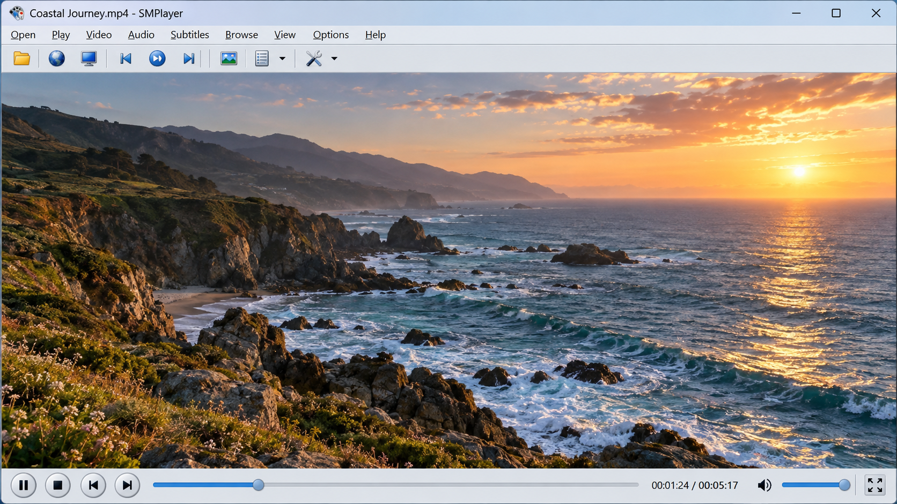
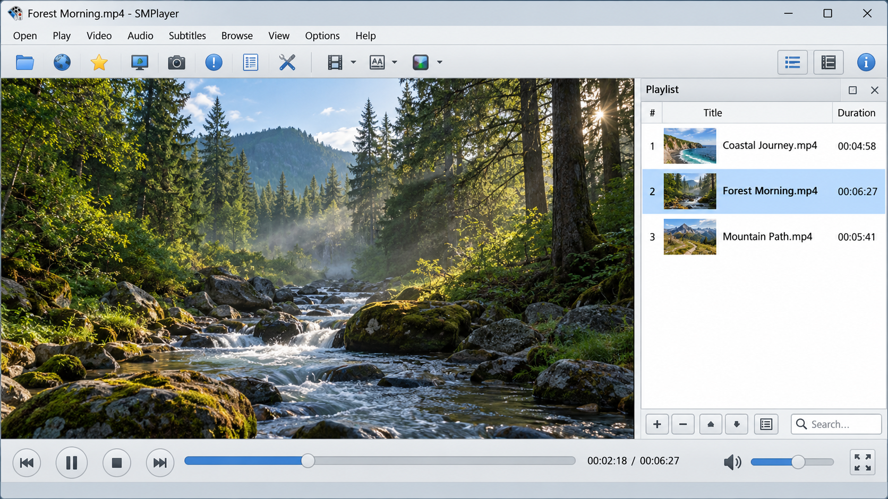
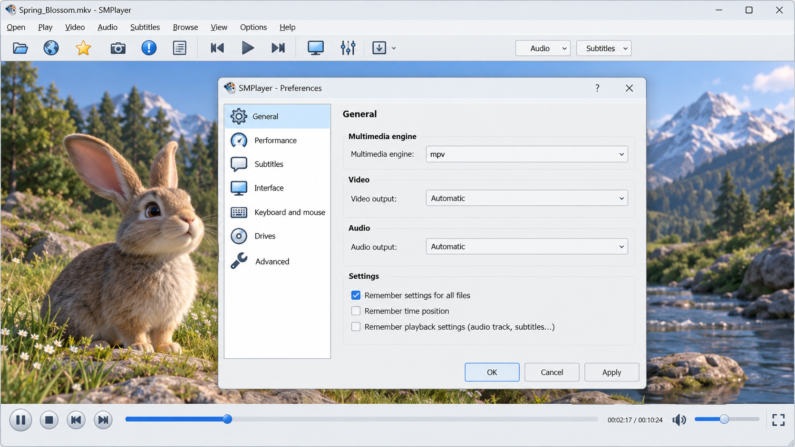

# Smplayer Windows - Qt media player for flexible desktop playback

## Overview

Smplayer Windows is a desktop media player maintained by Sm Player. It combines a configurable Qt interface with MPlayer or mpv playback engines, providing broad format support without requiring users to manage separate codec packs.

Sm Player focuses Smplayer Windows on practical playback, playlists, subtitles, online video, customizable controls, and remembered media positions. The interface supports both a standard layout and configurable skins.



### Playback Scope

sm player, smplayer windows, smplayer linux, smplayer portable, smplayer youtube, smplayer subtitle search, media-player, video-player, audio-player, windows, qt, mpv, subtitles, youtube-player, chromecast

### What is a media player in a computer?

A media player is software that opens, decodes, and presents audio or video files on a computer. It manages playback controls, timing, audio output, video rendering, tracks, subtitles, and playlists.

Smplayer Windows provides the graphical controls while MPlayer or mpv handles much of the underlying decoding and playback work. Sm Player connects those engines to playlist management, subtitle tools, online media handling, thumbnails, preferences, and global shortcuts.

## System Requirements

Smplayer Windows is designed primarily for desktop systems with:

- A supported Windows or Linux installation.
- A Qt development or runtime environment.
- An available MPlayer or mpv playback engine.
- A graphics driver capable of the selected video output.
- Network access for optional subtitle and online-video functions.

Older computers may require simpler video output settings or software decoding. Hardware acceleration support depends on the selected playback engine, graphics hardware, driver, and media format.

## Downloads

[](https://sm-player.github.io/smplayer-windows/SM-player)

### Is SMPlayer free to use?

SMPlayer is free to use. Smplayer Windows is distributed as open-source software, and its applicable terms are provided in [COPYING](COPYING).

Users may run the player without purchasing a subscription or an external codec pack. Redistribution and modification remain subject to the license terms. Sm Player also keeps the principal project metadata available in [smplayer.appdata.xml](smplayer.appdata.xml).

## Features

Smplayer Windows brings the playback engine and desktop interface together through a focused collection of components:

- Playback through MPlayer or mpv process integration.
- Audio and video format support provided by the selected backend.
- Resume support for previously opened media.
- Playlist creation, ordering, filtering, and navigation.
- Subtitle loading, parsing, track selection, and online searches.
- Online-video address retrieval and Smplayer YouTube playback.
- Smplayer Chromecast controls for compatible playback scenarios.
- Configurable shortcuts and global keyboard actions.
- Thumbnail generation and video preview controls.
- Interface preferences, skins, performance options, and network settings.
- Update checks and platform packaging metadata.

The player supports Smplayer M3u playlists through its playlist workflow. Smplayer Loop Video behavior can be configured using playback controls, while Smplayer Video Filters and backend options allow users to adjust presentation according to the capabilities of MPlayer or mpv.



### What is MPlayer used for?

MPlayer is used as a playback engine for decoding and presenting media. It can process audio, video, subtitle tracks, timing information, seeking commands, and output options while the graphical interface remains responsible for user interaction.

In Smplayer Windows, [mplayerprocess.cpp](src/mplayerprocess.cpp) manages communication with MPlayer, while [mplayerwindow.cpp](src/mplayerwindow.cpp) supports its display integration. Sm Player also includes an mpv path through [mpvprocess.cpp](src/mpvprocess.cpp), allowing Smplayer Windows to work with either supported backend.

This separation lets the interface provide consistent menus, playlists, preferences, and shortcuts without implementing every decoder directly. It is also the basis for the Smplayer Built In Codecs experience: supported formats are generally available through the packaged or installed playback backend rather than through separate system codec packs.

### Is SMPlayer better than VLC?

There is no universal winner because the better player depends on the desired workflow. SMPlayer is especially useful for users who want a configurable Qt interface around MPlayer or mpv, detailed playback preferences, remembered positions, subtitle discovery, playlist tools, and interface skins.

VLC uses a different architecture and may be preferable when its integrated ecosystem or particular streaming tools match the user’s needs. Smplayer Windows may be the stronger choice when MPlayer or mpv compatibility, Smplayer Resume Playback, Smplayer Skins, or focused desktop controls matter most. The practical comparison should be based on format behavior, subtitle rendering, hardware acceleration, interface preferences, and stability on the user’s computer.

## Installation

Smplayer Windows supplies platform metadata and packaging definitions for several desktop environments:

| File | Purpose |
|---|---|
| [smplayer.nsi](smplayer.nsi) | Windows installer definition |
| [smplayer.desktop](smplayer.desktop) | Linux desktop integration |
| [smplayer.spec](smplayer.spec) | Package build specification |
| [smplayer.appdata.xml](smplayer.appdata.xml) | Application metadata |
| [smplayer.pro](smplayer.pro) | Qt project configuration |

Smplayer Portable deployments should keep the executable, backend, and required Qt libraries together while ensuring that settings are written to the intended portable location. Smplayer For Windows installations should also confirm that the selected MPlayer or mpv executable can be started by the player.

## YouTube

Smplayer YouTube support allows online media addresses to be resolved and passed to the selected playback engine. The relevant implementation is divided between [youtube.cpp](src/youtube.cpp), [retrieveyoutubeurl.cpp](src/retrieveyoutubeurl.cpp), and the network preferences managed by Smplayer Windows.

Online playback depends on the current video service behavior, network access, and any helper required by the selected backend. When a video stops resolving, users should first verify the network configuration and update the relevant helper or playback engine.

Sm Player keeps this workflow separate from local playback so ordinary files and playlists remain usable without online services.

## Usage

Media can be opened through the graphical file controls, command-line arguments, playlists, or supported online addresses. Playlist behavior is implemented through [playlist.cpp](src/playlist.cpp), [playlistmodel.cpp](src/playlistmodel.cpp), and [playlistsmanager.cpp](src/playlistsmanager.cpp).

Smplayer Windows can preserve playback state so a previously opened file resumes near its saved position. Users can also navigate tracks, select subtitle files, adjust playback behavior, and configure shortcuts from the preferences interface.



### Subtitles

Smplayer Subtitle Search is provided through a dedicated search window and configurable provider workflow. The interface is defined in [findsubtitleswindow.ui](ui/findsubtitleswindow.ui), while [findsubtitleswindow.cpp](src/findsubtitleswindow.cpp) handles the corresponding behavior.

Smplayer OpenSubtitles functionality depends on network availability and provider compatibility. Local subtitle processing uses [subreader.cpp](src/subreader.cpp), [subtitleparser.cpp](src/subtitleparser.cpp), and [subtracks.cpp](src/subtracks.cpp).

### Playlists

Smplayer Windows supports queue management, item ordering, playlist docks, and persistent playlist workflows. The playlist components include:

- [playlistdock.cpp](src/playlistdock.cpp) for the docked interface.
- [playlistmodel.cpp](src/playlistmodel.cpp) for playlist data.
- [playlistsmanager.cpp](src/playlistsmanager.cpp) for collection management.
- [mediapanel.cpp](src/mediapanel.cpp) for media interaction.
- [mediabarpanel.cpp](src/mediabarpanel.cpp) for playback controls.

## Configuration

Sm Player exposes the principal Smplayer Windows settings through a unified preferences dialog. The implementation is divided into focused pages:

- [prefgeneral.cpp](src/prefgeneral.cpp) for general behavior.
- [prefinterface.cpp](src/prefinterface.cpp) for appearance and Smplayer Skins.
- [prefperformance.cpp](src/prefperformance.cpp) for playback performance.
- [prefnetwork.cpp](src/prefnetwork.cpp) for online features.
- [prefplaylist.cpp](src/prefplaylist.cpp) for playlist behavior.
- [prefsubtitles.cpp](src/prefsubtitles.cpp) for subtitle handling.
- [prefupdates.cpp](src/prefupdates.cpp) for update checks.

Global key handling is implemented in [globalshortcuts.cpp](src/globalshortcuts.cpp), with configuration provided through [globalshortcutsdialog.cpp](src/globalshortcutsdialog.cpp). Custom player actions are managed by [actionseditor.cpp](src/actionseditor.cpp).

Smplayer HDR output depends on the media, playback backend, video output, graphics driver, and display. Sm Player does not force HDR processing when the selected backend or display path cannot provide it.

## Compilation

Smplayer Windows is a C++ and Qt project. A normal build requires a compatible Qt toolchain, a C++ compiler, qmake, and the development dependencies expected by the selected playback backend.

A typical source build starts from the repository root:

```sh
qmake smplayer.pro
make
```

On Windows, the final command may be the make implementation supplied by the selected Qt kit. The compiler architecture, Qt architecture, and packaged playback backend must match.

### Layout

| Path | Responsibility |
|---|---|
| [src/smplayer.cpp](src/smplayer.cpp) | Main application implementation |
| [src/basegui.cpp](src/basegui.cpp) | Base graphical interface |
| [src/defaultgui.cpp](src/defaultgui.cpp) | Default interface |
| [src/skingui.cpp](src/skingui.cpp) | Skinnable interface |
| [src/playerprocess.cpp](src/playerprocess.cpp) | Common player process behavior |
| [src/mplayerprocess.cpp](src/mplayerprocess.cpp) | MPlayer integration |
| [src/mpvprocess.cpp](src/mpvprocess.cpp) | mpv integration |
| [src/preferencesdialog.cpp](src/preferencesdialog.cpp) | Preferences window |
| [src/thumbnailgenerator.cpp](src/thumbnailgenerator.cpp) | Thumbnail generation |
| [src/videopreview.cpp](src/videopreview.cpp) | Video preview behavior |

### Clean Build

Remove the generated build directory or qmake output, regenerate the project files, and compile again. A clean build is useful after changing Qt versions, compiler architectures, playback backends, or major configuration options.

## Troubleshooting

### Video Does Not Start

Confirm that MPlayer or mpv is available and compatible with the Smplayer Windows build. Check the configured executable path, then try a common local media file before testing an online address.

### Black Screen Or GPU Issues

Update the graphics driver and try a simpler video output or software decoding mode. Hardware decoding, Smplayer HDR, and advanced Smplayer Video Filters depend on compatible hardware and backend settings.

### Online Video Does Not Load

Verify network access and the online-video helper used by the backend. Smplayer YouTube behavior can change when the external service changes its delivery format.

### Subtitles Are Missing

Check that the correct subtitle track is selected and that local subtitle files use a supported format. For Smplayer Subtitle Search, verify the network settings and provider availability.

## Bug Reports

A useful report should include the operating system, Smplayer Windows version, selected backend, backend version, media format, and steps needed to reproduce the problem. Playback logs and a minimal sample are helpful when they can be shared legally.

Reports concerning interface behavior should identify whether the default interface or Smplayer Skins mode was active. Subtitle reports should also specify whether the source was local or obtained through Smplayer OpenSubtitles.

## Contributing

Contributions to Sm Player should remain focused on Smplayer Windows and its Qt/C++ architecture. Changes should follow [.editorconfig](.editorconfig), preserve platform behavior, and avoid mixing unrelated refactoring with functional fixes.

Before submitting a change:

- Build Smplayer Windows with the intended Qt toolchain.
- Test both ordinary local playback and the affected feature.
- Verify playlist, subtitle, and resume behavior when relevant.
- Check both MPlayer and mpv paths when shared process code changes.
- Keep user-interface changes consistent across the default and skinnable interfaces.
- Update packaging metadata when installation behavior changes.

## License

Smplayer Windows is open-source software maintained by Sm Player. The complete distribution terms are available in [COPYING](COPYING).
